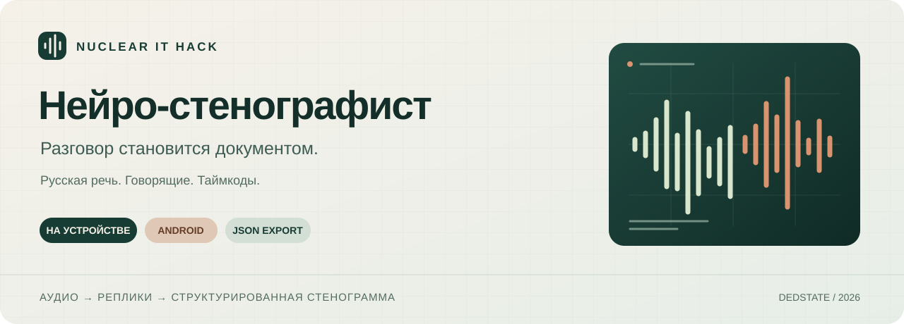

<p align="center">
  
</p>

<p align="center">
  <a href="https://github.com/Dedstate/neuro-stenographer/actions/workflows/android.yml"></a>
  
  
  
</p>

<p align="center">
  <a href="#возможности">Возможности</a> ·
  <a href="#попробовать">Попробовать</a> ·
  <a href="docs/BUILD.md">Собрать</a> ·
  <a href="docs/ARCHITECTURE.md">Архитектура</a> ·
  <a href="docs/DEMO.md">Демонстрация</a>
</p>

# Нейро-стенографист

Android-приложение для расшифровки русскоязычных разговоров. Выберите запись, запустите обработку и получите текст с идентификаторами говорящих и временными метками. Результат можно прочитать на телефоне и сохранить в JSON.

**Аудио обрабатывается на устройстве. Все модели входят в APK, отдельное скачивание при первом запуске не требуется.** В манифесте приложения нет разрешения на интернет.

Проект подготовлен для Nuclear IT Hack, кейс «Нейро-стенографист».

## Возможности

| Функция | Как работает |
|---|---|
| Импорт записи | Системный выбор WAV, MP3 или M4A |
| Распознавание | GigaAM v2 CTC INT8, русский язык |
| Говорящие | Сегментация pyannote и голосовые эмбеддинги 3D-Speaker |
| Таймкоды | Начало и конец каждого речевого фрагмента в миллисекундах |
| Читаемый текст | RUPunct_small восстанавливает пунктуацию и регистр |
| Экспорт | JSON по структуре кейса, без служебных полей |
| Сохранение | Последний успешный результат доступен после перезапуска |
| Управление | Статус этапа, прогресс диаризации и запрос отмены |

Текущая версия работает с записями до **10 минут / 512 МиБ**. Запись с микрофона пока не добавлена. Сжатые форматы используют декодеры Android; поддержка зависит от устройства.

## Попробовать

1. Скачайте APK из [артефактов последней успешной сборки](https://github.com/Dedstate/neuro-stenographer/actions/workflows/android.yml), если сборка уже выполнена. Для скачивания артефактов GitHub может потребоваться вход. Либо [соберите приложение](docs/BUILD.md).
2. Установите APK на Android 8.0+ с ARM64 или x86_64. Для APK, моделей и временных файлов желательно иметь 1.5-2 ГБ свободного места.
3. Включите авиарежим до первой обработки и выберите **«Импортировать аудио»**.
4. Дождитесь стенограммы и нажмите **«Экспорт JSON»**.

Для первого прогона в репозитории есть [короткий диалог](artifacts/test_audio/dialogue.wav). Сценарий показа и список проверок находятся в [DEMO.md](docs/DEMO.md).

## Что внутри

| Этап | Модель | Веса, примерно |
|---|---|---:|
| Речь в текст | GigaAM v2 CTC INT8 | 226 МиБ |
| Сегментация речи | pyannote segmentation 3.0 | 5.7 МиБ |
| Признаки голоса | 3D-Speaker ERes2Net | 37.8 МиБ |
| Пунктуация и регистр | RUPunct_small INT8 | 27.6 МиБ |

Модели выполняются последовательно. После диаризации освобождаются её ресурсы, затем запускается распознавание и в конце пунктуация. ASR обрабатывает фрагменты длиной до 20 секунд. Это ограничивает размер отдельного запуска, но фактический пик памяти зависит от устройства.

Sherpa-ONNX 2.0.1 обслуживает ASR и диаризацию. Java JNI-мост ONNX Runtime собран под комплектный runtime Sherpa 1.28.2. Пунктуация не переписывает стенограмму: после неё проверяется сохранность последовательности слов.

[Подробнее об архитектуре](docs/ARCHITECTURE.md) · [Модели и лицензии](docs/THIRD_PARTY.md)

## Формат результата

Пример структуры, без привязки к конкретному тесту:

```json
{
  "transcript": [
    {
      "speaker_id": "speaker_1",
      "start_ms": 1250,
      "end_ms": 4380,
      "text": "Добрый день!"
    }
  ]
}
```

Идентификатор относится к голосу внутри одной записи. Приложение не устанавливает личность человека и не связывает участников разных встреч. [Полный контракт JSON](docs/PROTOCOL.md).

## Проверка проекта

- 15 JVM-тестов: аудио, таймкоды, JSON, токенизация и JNI-callback.
- 6 Python-тестов: проверка схемы, расчёт WER и разбор нативных символов.
- Проверка APK: SHA-256 моделей, совместимость ELF, callback в DEX и отсутствие `INTERNET`.
- Android smoke-тест: загрузка моделей и инференс в одном процессе на подключённом устройстве.
- Получен пользовательский экспорт пятиминутной записи: 68 фрагментов, последнее окончание 299.967 с.

В этом экспорте обнаружено **15 ID говорящих**, включая смену ID внутри монолога. Разделение спикеров остаётся основной задачей по качеству. WER, DER, скорость и пик памяти на устройстве с 4 ГБ пока не измерены. Сборочные тесты не заменяют эти измерения.

[Результаты проверок](docs/TEST_RESULTS.md) · [Ограничения](docs/LIMITATIONS.md)

## Сборка

Нужны JDK 17/21, Python 3.11+, Android SDK 35 и `readelf` из binutils.

```bash
python3 scripts/prepare_models.py
./gradlew :app:testDebugUnitTest :app:lintDebug :app:assembleDebug
python3 scripts/check_apk.py android/app/build/outputs/apk/debug/app-debug.apk
```

APK появится в `android/app/build/outputs/apk/debug/app-debug.apk`.

Модели скачиваются на компьютере разработчика до сборки. В приложение они попадают как встроенные assets. Веса и native libraries закреплены по SHA-256; сборка без необходимых файлов завершается ошибкой.

[Подробная установка среды для Linux/Fedora](docs/BUILD.md) · [Работа с кодом](CONTRIBUTING.md)

## Структура

| Папка | Содержимое |
|---|---|
| [`android/`](android/) | Основное Android-приложение и тесты |
| [`scripts/`](scripts/) | Подготовка моделей и проверка артефактов |
| [`docs/`](docs/) | Архитектура, сборка, демонстрация, ограничения |
| [`artifacts/`](artifacts/) | Тестовое аудио и результаты проверок |
| [`experiments/`](experiments/) | Ранние прототипы, сохранённые при объединении веток |

Корневой `./gradlew` запускает основной проект из `android/`. В Android Studio открывайте папку `android/`.
