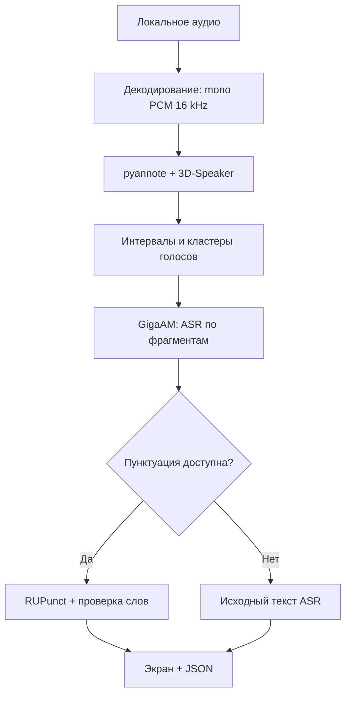

# Архитектура

Основной проект написан на Kotlin. UI запускает одно задание в worker-потоке; модели выполняются последовательно. Сеть не участвует в распознавании, диаризации или постобработке.

## Конвейер

## Аудио

`AudioDecoder` получает файл через Android Storage Access Framework и создаёт ограниченную временную копию. Для WAV используется собственный разбор PCM16/24/32 и Float32; сжатые форматы декодируются MediaCodec. Каналы усредняются до mono, затем `Resampler` переводит сигнал в 16 kHz через оконный sinc-фильтр. Временный файл удаляется после декодирования.

Ограничения: до 10 минут и 512 МиБ исходного файла. Полный FloatArray PCM16k занимает примерно 36.6 МиБ на 10 минут; это не включает модели и нативные активации.

## Диаризация

Sherpa pyannote выделяет речевую активность, 3D-Speaker строит признаки голосов. FastClustering определяет число кластеров автоматически, текущий threshold = 0.5. ID перенумеровываются по первому появлению. Границы ограничиваются длительностью записи.

Перекрытия разных спикеров сохраняются с предупреждением. Разделения смешанной речи на отдельные звуковые источники нет. После этапа диаризации модели освобождаются.

## ASR и таймкоды

GigaAM v2 CTC INT8 распознаёт каждый интервал. Длинные интервалы режутся на части до 20 секунд; граница выбирается возле минимума энергии. Нарезка покрывает интервал без пропусков семплов. На каждый фрагмент создаётся и освобождается OfflineStream, затем освобождается ASR.

Таймкоды относятся к интервалу/фрагменту ASR, а не к каждому слову. В JSON они сохраняются целыми миллисекундами от начала записи.

## Пунктуация

RUPunct_small выполняет классификацию токенов. Используются закреплённый WordPiece-словарь, три входных int64 тензора и блоки до 256 токенов. Метка первого subword применяется к исходному слову. После изменения регистра и пунктуации проверяется сохранность лексической последовательности.

Строки с неподдерживаемыми символами возвращаются без изменений. При обычной ошибке пунктуации сохраняется ASR-текст и показывается предупреждение. Резюме и свободная генерация текста в конвейер не входят.

## Нативные зависимости

Kotlin API и JNI Sherpa имеют версию 2.0.1. Из официального Android-архива берутся Sherpa JNI и его ORT 1.28.2. Java classes.jar происходит из ORT 1.28.0, Java JNI-мост пересобран линковщиком против того же runtime 1.28.2 для обеих ABI.

Значение имеют точные ELF-версии символов. Совпадение номера C API не гарантирует совпадение `OrtGetApiBase@VERS_1.28.2`. `check_apk.py` проверяет это в итоговом APK.

Sherpa 2.0.1 ожидает у callback метод `invoke(IIJ)Ljava/lang/Integer;`. `DiarizationProgressCallback` реализован именованным классом, поскольку Kotlin 2 indy-lambda не предоставляет этот метод. JVM-тест и проверка DEX защищают от регрессии.

## Хранение и жизненный цикл

Модели включаются в assets и при первой обработке копируются в приватное хранилище с проверкой SHA-256. На следующих запусках используются файлы с маркером нужной версии; полное повторное хэширование каждой копии при каждом запуске не выполняется.

Последний успешный JSON сохраняется через временный файл и переименование. При отмене/ошибке предыдущий результат остаётся доступен. Activity удерживает экран включённым; её уничтожение запрашивает отмену. Foreground service и восстановление прерванного задания пока отсутствуют. Нативная диаризация может завершиться раньше, чем будет обработан запрос отмены.

## Границы модулей

`MainActivity` отвечает за взаимодействие с пользователем, `Pipeline` за этапы и ресурсы, `Transcript` за интервалы и экспорт. Модели и токенизаторы не зависят от содержимого конкретных тестовых записей. Все зависимости ранних прототипов находятся в `experiments/` и не подключаются к основной сборке.
